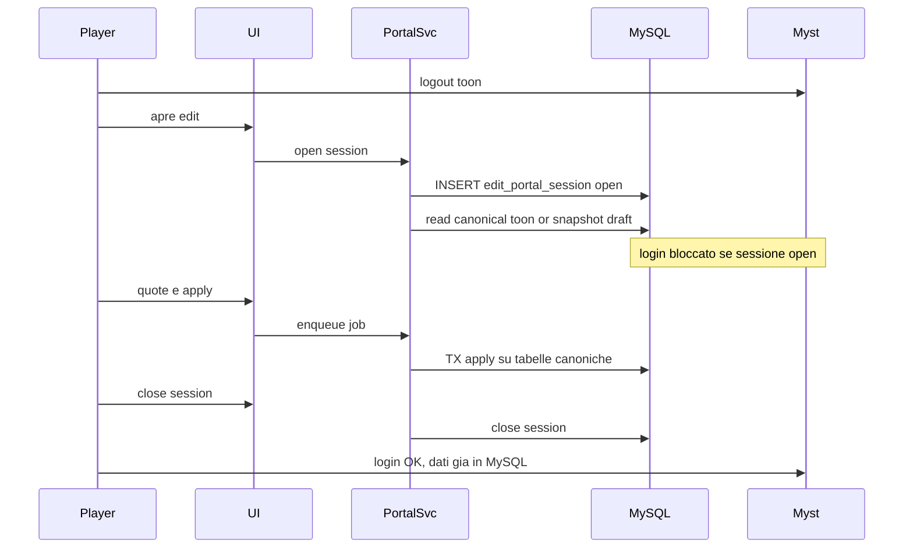

# Portale edit asincrono: stesso DB vs parallelo, sync, lag, semaforo

Riferimento: [proposta-architettura-portale-montero.txt](docs/patches/portale-produzione/proposta-architettura-portale-montero.txt) (soluzione **1+2+6**). Schema sessione gia' abbozzato in myst: `edit_portal_session` / `edit_portal_event` in [odb_schema_heal.cpp](src/odb_schema_heal.cpp).

## Verdetto: stesso MySQL, non un DB parallelo

**Conviene usare lo stesso database di gioco** (stessa istanza MySQL, stesso schema `nebbie` o al massimo un secondo *schema* sullo stesso server per tabelle portale). **Non** un secondo database/server da tenere allineato in continuo.

| | Stesso DB | DB parallelo (copia PG) |
|--|-----------|-------------------------|
| Dati "sempre aggiornati" | Lettura diretta delle tabelle canoniche a apertura sessione | Serve sync continua o snapshot + riconcilia: e' la fonte del lag/incoerenza |
| Lag su myst | Solo check semaforo a login (+ opz. flag online) | Stesso semaforo **piu'** job di replica/allineamento |
| Apply | Una transazione: bozza -> tabelle canoniche | Apply = merge tra due mondi (conflitti XP/rent/login) |
| Complessita' | Media (coda + sessione) | Alta, fragile a 10 utenti e inutile a questa scala |

Il problema di lag del prototipo **non** e' "MySQL condiviso": e' **lavoro pesante sul pulse di myst**. Togliere quote/apply dal game loop basta; duplicare il DB aggiunge sync senza ridurre quel lavoro.

## Come strutturarlo (meno lag di allineamento possibile)

**Fonte di verita' canonica:** le tabelle personaggio/inventario che myst gia' usa a load/save.

**Tabelle portale (stesso DB):**
- `edit_portal_session` — una sessione aperta per toon; TTL; owner account
- `edit_portal_job` — coda apply (`pending` / `running` / `done` / `failed`), una `running` per toon
- bozza opzionale: `edit_portal_draft` (JSON o righe) **solo per la sessione**, non un secondo inventario "vivo"
- audit gia' previsto: `edit_portal_event`

**Modello sync "efficiente" (in realta': evitare la sync continua):**
1. **Apertura sessione:** snapshot versionato (`toon_id` + `row_version` / `updated_at` / checksum inventorio). Il giocatore lavora su bozza o su letture ripetute delle canoniche **solo perche' il toon e' offline e bloccato al login**.
2. **Durante la sessione:** nessuna replica verso un altro DB. Myst non scrive quel toon (non e' in gioco). Unico scrittore = servizio portale (job).
3. **Apply:** una TX MySQL (addebito + mutate inventorio + job done). Se la versione canonica e' cambiata (caso anomalo) -> fail chiaro, niente merge silenzioso.
4. **Chiusura:** sessione closed; al login successivo myst carica MySQL come oggi -> vede gia' l'edit.

Quindi "dati sempre aggiornati" = **mutex di dominio** (semaforo + offline), non CDC/replication.

## Stima lag a 10 account contemporanei

Ipotesi: 10 sessioni portale aperte; apply non sul pulse; myst e MySQL sullo stesso host o LAN.

| Percorso | Impatto su pulse myst | Ordine di grandezza |
|----------|----------------------|---------------------|
| Check semaforo a **tentativo di login** del toon in edit | 1 query indexed su `edit_portal_session` | ~1 ms tipico; solo al login, non ogni pulse |
| Flag online enter/exit (opzionale) | 1 write a enter/exit | Irrilevante a 10 PG |
| Quote / lista inventorio / preventivi | **0** sul pulse (servizio esterno) | Carico MySQL parallelo: a 10 utenti e' rumore |
| Apply (job worker) | **0** sul pulse | Decine–poche centinaia ms a job a seconda pezzi; 10 job in parallelo su toon diversi ok; stesso toon serializzato |

**Conclusione affidabile a questa scala:** con 1+2+6 il portale **non** dovrebbe introdurre hitch di combat/comandi. Il rischio residuo e' solo **saturazione MySQL** se apply enormi e mal indizzati — mitigato da coda, indici su `toon_id`/`status`, e una job running per toon. Non serve un DB dedicato per 10 utenti.

Se un giorno si volesse isolare I/O: stesso MySQL, pool connessioni dedicato al servizio portale e limiti `max_execution` / rate apply — non un secondo database personaggi.

## Semaforo myst: struttura e UX

**Cosa fa myst (Fase 1 della proposta):**
- A login (dopo auth, prima di entrare in play): `SELECT` sessione `open` per quel `toon_id` (e job `running` se si vuole essere stretti).
- Se aperta: rifiuta ingresso con messaggio ASCII chiaro (es. chiudere il portale / attendere fine apply).
- Non esegue quote/apply; non tocca inventorio per conto del portale.

**Regole:**
- Una sessione per toon; apply solo con sessione open e toon non online.
- Timeout sessione (browser chiuso) + blocco chiusura se job ancora `running`.
- Opzionale: myst scrive `online=1/0` a enter/exit cosi' il servizio non deve indovinare.

**Esperienza di gioco:**
- Per editare: **esci dal mud**, apri portale, lavora, chiudi sessione (o attendi timeout), **rientra**.
- Se dimentichi il portale aperto: al login vedi il blocco — non perdi il PG, non combatti "a meta'"; e' un gate esplicito.
- Chi e' in gioco e non usa il portale: **zero** differenza (nessun lavoro extra per pulse).
- Trade-off consapevole: non si edita "in parallelo" al PG online; e' il prezzo per coerenza senza sync e senza lag sul tick.

## Allineamento al piano Montero

Ordine gia' proposto, invariato:
1. Semaforo + tabella sessione (anche col prototipo attuale)
2. Servizio esterno sola lettura
3. Coda apply
4. Tolto il path pesante dal pulse per i giocatori
5. Prove race (login durante sessione, doppio tab, 10 apply)

Niente fase "alza un secondo DB personaggi".
